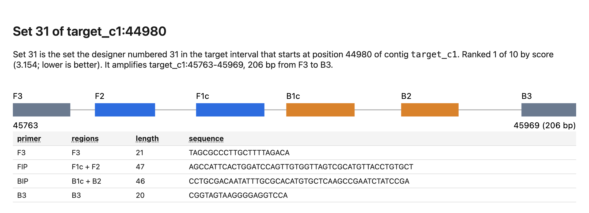
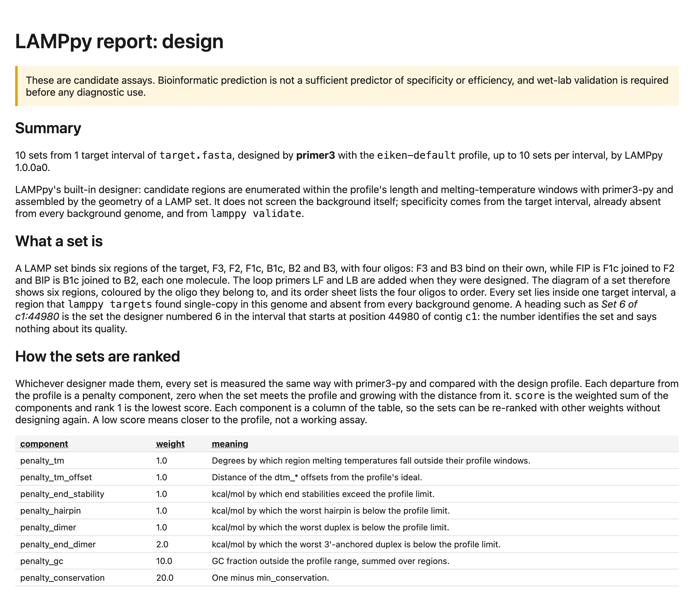
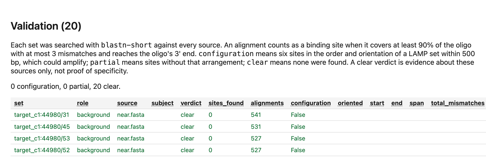

# The report

`lamppy report` turns the tables of one run directory into a single self-contained HTML file.
It reads only what `design` and `validate` wrote, so it can be regenerated at any time and
never recomputes anything.

```bash
lamppy report --run work/design                 # writes work/design/report.html
lamppy report --run work/design --top 10        # detail the ten best sets
lamppy report --run work/design --out run.html  # write it elsewhere
```

`lamppy run` writes the report at the end of every run.



The images on this page come from the [quickstart](quickstart.md) toy genomes, designed with
`--backend primer3` and validated against `near.fasta` and `far.fasta`.

## Summary, sets and ranking

The report opens with the statement that every set is a candidate assay, then says what was
designed, from which genome, by which designer (with the GLAPD commit when the image
recorded one) and under which profile, and what that designer did.

Two short sections follow, because they are what the tables are read against:

- **What a set is.** Six binding regions, F3, F2, F1c, B1c, B2 and B3, carried by four
  oligos: F3 and B3 on their own, FIP joining F1c to F2 and BIP joining B1c to B2. Every set
  lies in one target interval, and a heading such as *Set 6 of c1:44980* is the set the
  designer numbered 6 in the interval starting at position 44980 of contig `c1`. That number
  identifies the set; it says nothing about its quality.
- **How the sets are ranked.** Each departure from the profile is a penalty component,
  `score` is their weighted sum and rank 1 is the lowest score. The table lists the weight
  this run used for every component.



## Ranked sets

One row per set, in rank order, with every number behind the ranking: coordinates, amplicon
length, score, the worst hairpin and dimer free energies, the melting-temperature offsets and
one `penalty_*` column per score component. Hovering a column heading shows what it means.
The columns are described in [Output formats](outputs.md#design).

## The top sets

Each of the `--top` best sets gets its own section:

- a sentence placing it: its interval, its rank and score, and the amplified span;
- a to-scale diagram of the six binding regions, coloured by the oligo that carries them
  (FIP in blue, BIP in orange, F3 and B3 in grey), so the four oligos of the order sheet can
  be matched to the six regions of the diagram;
- the order sheet: each oligo, the regions it joins, its length and its sequence, 5' to 3'.

## Validation

When `lamppy validate` has run in the same directory, the report states how the sets were
screened (`blastn-short`, the coverage and mismatch thresholds a binding site must meet, the
span a configuration must fit in), tallies the verdicts and gives one evidence row per set
and source.



A `clear` verdict is evidence about the sources that were screened, not proof of
specificity. See [Limitations](limitations.md).

## Provenance

The report ends with the manifest of each stage: LAMPpy version, command, timestamp,
platform, resolved parameters, external tool versions, and every input with its SHA-256.
